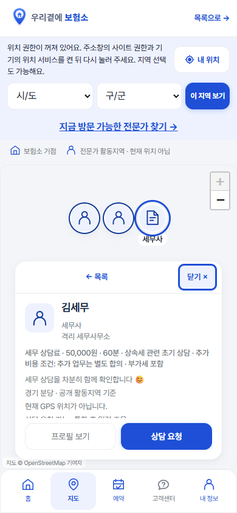
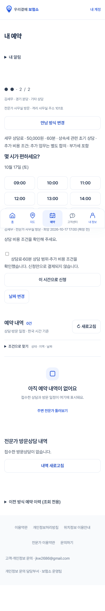
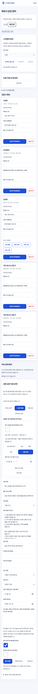
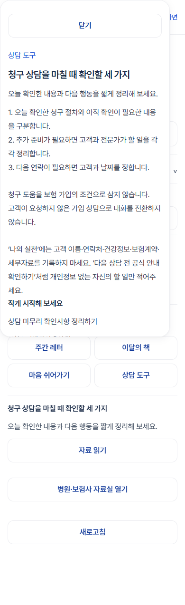

# 전문가 통합 후속 작업 결과 — 2026-10-12

## 현재 판정

**개발 구현·격리 검수 완료. 운영 DB 적용·배포·과금·외부 발송·운영 게시 없음.**

시작점은 깨끗한 `codex/mobile-ui-polish`의 `7acb6b7`. 이어서 `codex/expert-integration`에서 작업했다. 먼저 완료한 UI 변경을 포함하는 개발 브랜치이며, 운영 main을 뜻하지 않는다. 기존 디자인을 다시 개편하지 않았다.

## 구현 / 재사용 / 미완료

| 구분 | 결과 |
|---|---|
| 홈 | 기존 위치의 문장을 “보험 가입 권유 없이, 청구부터 도와드립니다.”로 교체. 구조·브랜딩·버튼 유지 |
| 설계사 원칙 | 독립된 필수 원칙 영역, 굵은 진한 빨간 금지·제재 문구, 기본 미선택·전체 문구 클릭, 서버 버전 검증 |
| 동의 | 기존 consent_records 재사용. 계정·시각·버전 기록, 중복 억제, 기존 회원 소급 동의 없음. 단순 수정에 반복 동의 강요 없음 |
| 세무사 | 실제 개방 플래그에 따른 유형 선택, 등록번호·소속·세무 분야, 등록 확인 자료, 관리자 확인·승인, 선택 사진·소개·도움 업무 |
| 지도 | 사람과 장소를 유지하고 세무사는 문서 아이콘·직역명으로 구분. 기존 사진·상세보기·활동지역 표시 재사용 |
| 만남·예약 | 실제 설정한 사무실 방문 / 보험소에서 만나기 / 전문가 방문. 선택 전문가·장소 보존. 기존 요청·수락·확정·변경·취소 흐름 재사용 |
| 시간 | 새 통합 요청은 60분, 09~17시 시작. 전문가 요일·시간 및 실제 보험소 이용 가능 시간 함께 검사. 기존 18시 시작·기존 길이 소급 변경 없음 |
| 상담료 | 세무사만 무료 / 유료 / 사전 확인 필요. 유료 금액·범위·추가 비용·세금 안내 필수, 요청 전 체크 및 신청 당시 조건 보존 |
| 첫 콘텐츠 | 기존 비공개 첫 원고 식별자를 유지. 대표가 불러와 수정·저장·검토·게시할 수 있는 기존 자료 운영 재사용 |
| 약관 | 변경 전후 문서와 개발 검토 화면 작성. 운영 약관·개인정보처리방침 변경 없음 |
| 미완료 | 소비자 보호 위반 1·2·3회 기간별 집행·이의 신청의 완전한 운영 절차. 안내와 실제 기존 제재 기능에 차이가 있음 |
| 개방 보류 | 세무사·통합 예약 플래그는 기본 OFF. 신규 직군 요금·무료기간·공개 범위·최종 약관 및 재동의는 대표 결정과 법률 검토 필요 |

## 수정 파일

- 홈·지도: `public/index.html`, `public/home-map.js`, `public/map.js`, `public/expert-profile-card.js`, `public/office-slot.js`, `src/directory.js`.
- 가입·동의·심사: `src/expert-policy.js`, `src/expert-early-access.js`, `src/partner-onboarding.js`, `src/early-documents.js`, `src/early-expert-admin.js`, `netlify/functions/expert-documents.mts`.
- 프로필·상담·예약: `src/account.js`, `src/optional-profile.js`, `src/consultation-options.js`, `src/consultation-ui.js`, `src/unified-request.js`, `src/office-request.js`, `src/request-intent.js`, `src/workflow.js`.
- 스타일: `public/account.css`의 기존 안내 영역과 `public/styles.css`의 전문가 마커·비용 문구 범위만 수정. 기존 토큰 사용.
- 약관·콘텐츠: `public/expert-policy-preview.html`, `data/growth-first-draft.json`, `src/growth-admin.js`, `src/growth.js`.
- DB 후보·원복: `supabase/062_expert_types_policy.sql`, `063_unified_expert_booking.sql`, `064_growth_summary.sql`, `rollback_expert_integration.sql`, `scripts/build-expert-integration-candidate.mjs`.
- 검수: `tests/expert-integration-fixture.mjs`, `expert-integration.test.mjs`, `expert-integration-browser.mjs`, `expert-documents-api.test.mjs`, `home-experts-browser.mjs`, `growth.test.mjs`, `growth-browser.mjs`.

## DB 후보와 권한

| 대상 | 변화 |
|---|---|
| private.expert_integration_settings | 세무사·통합 예약 공개 스위치. 단일 행, 기본 false. 일반 계정 직접 읽기·쓰기 금지 |
| private.expert_integration_backup | 적용 직전 함수 정의 보관. 재실행 시 처음 백업을 덮어쓰지 않음. 일반 계정 접근 금지 |
| private.expert_profiles | profession, declared_organization, registration_reference, consultation_options, tax_help_tasks 추가. 기존 행은 planner 기본값 |
| private.consultations | integration_details 추가. 선택 직역·방식·장소·당시 비용·확인 시각·중복 방지 정보 |
| 기존 기록 | 기존 회원·예약·동의·비공개 원고 삭제, 컬럼 삭제·타입 변경, TRUNCATE 없음. 기존 예약 시간·길이 일괄 수정 없음 |
| RLS | 신규 비공개 설정·백업에 RLS. 기존 비공개 테이블·관리자/본인 검사 유지 |
| RPC | 공개 capabilities/catalog/가능시간은 제한된 항목만. 설정·가입·요청은 로그인 본인 검사. 심사·첫 원고 로드는 관리자 검사. 이전 함수 별칭의 일반 계정 실행 권한 회수 |
| Storage | 새 버킷·공개 정책 없음. 기존 비공개 expert-documents와 서버 승인 후 다운로드 경로 사용. 사진은 기존 가공·버전 URL 사용 |

새 기능의 최종 개방 여부는 DB의 `private.expert_integration_settings`가 결정한다. Netlify에 같은 이름의 별도 개방 설정을 만들지 않았다. 기존 회원/예약 정책 gate, `service_features`, 자료 업로드 환경변수는 별도 필수 조건으로 유지하며 새 플래그가 이들을 무시하지 않는다.

세무사는 원래 설계사용 '지금 방문' 경로에 들어갈 수 없도록 서버 자격 검사에서도 제한했다. 새 요청은 시간과 비용을 확인하는 통합 경로로만 접수한다. 설계사의 기존 방문 기능은 유지한다.

개별 SQL은 각 한 트랜잭션이며 재실행을 검사했다. 묶음 생성기는 062~064를 하나의 외부 BEGIN/COMMIT으로 작성한다. 생성된 묶음도 격리 DB에서 두 번 실행했고, 끝부분에 의도적으로 오류를 넣으면 같은 트랜잭션의 설정 변경이 취소되고 원고가 보존됨을 확인했다. 최종 묶음 SHA256은 504b649bf161b7749a0afc48ccf2332dfc24bb547b675e213343f29dab2231e1이다. 운영 적용 전에는 현재 운영 스키마·함수 정의·권한과 다른 작업의 SQL 번호를 비교하고 백업해야 한다. 이번 격리 검사는 운영 전체 스키마 동일성 확인을 대신하지 않는다.

## 확인한 화면

가상 계정·로컬 데이터로 캡처했다. 지도 타일은 외부 연결 차단으로 회색이며 운영 위치나 실제 인물이 아니다.

| 가입 원칙 | 세무사 프로필 | 세무사 지도 |
|---|---|---|
|  |  |  |

| 요청 전 비용 확인 | 관리자 첫 원고 | 전문가 읽기 |
|---|---|---|
|  |  |  |

## 기능 검수 결과

| 검사 | 결과·근거 |
|---|---|
| 새 설계사 필수 동의 누락·구버전 차단 | 통과. 실제 격리 SQL과 가입 페이지 모두 확인 |
| 기존 프로필 수정과 동의 이력 | 통과. 일반 수정에 새 동의 기록 없음, 명시적 동일 버전 동의 중복 없음 |
| 세무사 등록→자료 확인→승인 | 통과. 가입·재접속 UI, 비공개 메타데이터 저장·관리자 확인/승인 SQL 확인. 반려·보완 요청도 실제 저장 후 재접속 화면에서 구분됨 |
| 세무사 자료 | 잘못된 자료 종류 거부, 본인 목록 경로 비공개, 다른 사용자 다운로드 거부, 관리자 허용. HTTP 업로드는 가짜 Storage 응답으로 경로·오류 정리 확인 |
| 선택 사진·소개 | 기존 프로필 회귀 통과. 사진 변경·위치 조정·삭제·실패 fallback·캐시 및 소개 전체 표시 |
| 요일·시간·보험소 | 전문가 공개 시간만, 비운영 요일·보험소 휴무 차단. 09·17시 시작 허용, 18시·09:30 새 통합 요청 차단 |
| 선택 대상·비용 | 실제 운영 관계가 있는 전문가+보험소 함께 보존. 비용 확인 누락·오래된 조건 거부, 요청 당시 조건은 이후 설정 변경에도 보존 |
| 중복·권한 | 같은 요청 키 재전송 처리, 중복 시간 차단, 타인의 예약 조회·설정 변경·심사 실행 거부 |
| 기존 예약 | 기존 보험소 18시 시작 유지. 상담 OFF 이후 기존 확정 예약 유지. 신청을 확정으로 표시하지 않음 |
| 새 기능 OFF | 세무사 OFF 시 공개 목록/새 요청 차단. 등록 누락·미승인 및 별도 기존 정책 gate 유지 |
| 첫 콘텐츠 | 같은 식별자 1건 수정, 비공개 일반 조회 차단, 서버 관리자 전용 첫 원고, 미리보기·저장 실패 입력 보존·승인·게시·읽기·실천 추가·게시 중단 확인 |
| 기존 실천 | 추가·수정·완료·복구·삭제·새 인증 컨텍스트 재접속, 응답 유실 중복 방지 통과 |
| 기존 예약 목록 | 4폭·빈 상태·필터·새로고침·누름 영역 통과 |
| 홈 지도 | 320·360·390·1440px, 기존 핀 묶음·키보드·팝업·조회 실패 유지. 세무사 유형과 통합 요청 연결 확인 |
| 화면 | 새 흐름 6화면 360·390·430·1440px, 루트 폰트 200% 검사. 카드/대화창 좌우 경계 확인. 페이지 JS 오류 0 |
| 동의 대비 | 진한 빨간 문구 대비 5.97:1, 핵심 문구·제재 글자 굵기 700 이상 |
| 원복 | 진행 중 통합 예약이 있으면 원복 중단. 정리 후 두 번 원복·재적용, 기존 예약·동의 이력 보존 |

통합·예약·문서·성장 단위 검사 묶음은 18개 통과. 브라우저 결과는 [저장한 결과](expert-integration-browser-results.json) 참조.

검수 실행 순서(큰 브라우저 검사는 하나씩):

```text
node scripts/build.mjs
node scripts/build-expert-integration-candidate.mjs
node --test --test-concurrency=1 tests/expert-integration.test.mjs tests/growth.test.mjs tests/booking-hardening.test.mjs tests/expert-documents-api.test.mjs
node tests/expert-integration-browser.mjs
node tests/profile-usability-browser.mjs
node tests/requests-page-browser.mjs
node tests/growth-browser.mjs
node tests/home-experts-browser.mjs
```

실제 Google·SMS 로그인/실계정 저장, 실제 Supabase Storage 객체 전송, 실단말 키보드·카카오 브라우저·OS 글자 확대는 **미확인**. 새 선택값은 기존 요청 복귀 경로에 포함하지만 운영 OAuth 왕복은 실행하지 않았다. 전체 저장소 테스트를 모두 재실행한 것은 아니다.

## 첫 콘텐츠와 운영 상태

제목: **청구 상담을 마칠 때 확인할 세 가지**

요약: 오늘 확인한 내용과 다음 행동을 짧게 정리해 보세요.

실천: 상담 마무리 확인사항 정리하기

기존 첫 원고 식별자 `bohumso-after-meeting-five-minutes-v1` 유지. 새 문안을 관리자 전용 RPC에서 불러오므로 일반 프런트엔드 번들에 비공개 첫 원고를 싣지 않는다. 기존 비공개 원고를 덮어쓰기 전 확인하며, 저장 전에는 DB 원고가 그대로다. 공개된 원고가 있으면 자동 교체하지 않는다.

검토 환경에서는 실제 메모리 DB에 1개를 저장·승인·공개하고 전문가 목록/본문·실천 추가를 확인한 뒤 비공개 전환했다. **운영 첫 원고는 읽기·쓰기·게시하지 않았으며 현재 운영 공개 상태를 새로 확인하지 않았다.** 유료 AI·자동 수집·정기 게시를 켜지 않았다.

## 남은 결정·충돌·원복

- [약관 및 제재 차이·법률 검토·대표 결정 목록](expert-terms-integration-review.md).
- 다른 작업본 `../bohumso-ui-release`(codex/interaction-settings, 204bed6)의 미커밋 변경을 가져오거나 되돌리지 않았다. 계정·프로필·스타일·지도·예약 및 SQL 058 계열이 겹칠 수 있어 합칠 때 diff로 확인해야 한다. Claude Code가 지금 수정하는 내용은 직접 확인하지 못했다.
- 원복 SQL: [rollback_expert_integration.sql](../supabase/rollback_expert_integration.sql). 함수 정의를 선택적으로 복원하고 추가 컬럼·동의·예약·원고는 보존한다. 진행 중 새 통합 예약이 있으면 자동 원복을 막는다. 이후 추가한 별도 함수 변경은 먼저 비교해야 한다.
- 코드 복귀 기준은 7acb6b7. 이 브랜치 변경만 되돌리고 앞서 마친 UI와 다른 AI의 변경을 함께 취소하지 않는다. 운영에 적용한다면 DB와 코드의 호환 버전을 함께 관리해야 한다.
- 상시 로컬 미리보기 서버는 실행 중이지 않다. 첨부 화면과 재현 명령은 검토용이며 공개 배포 링크가 아니다.
