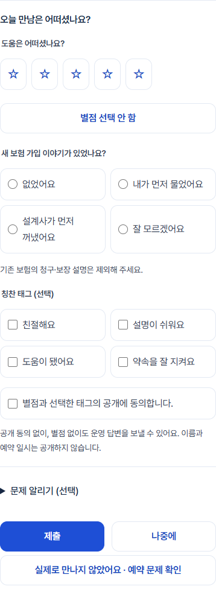
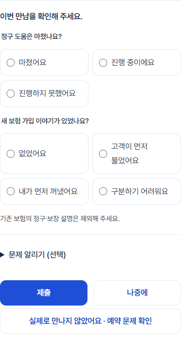
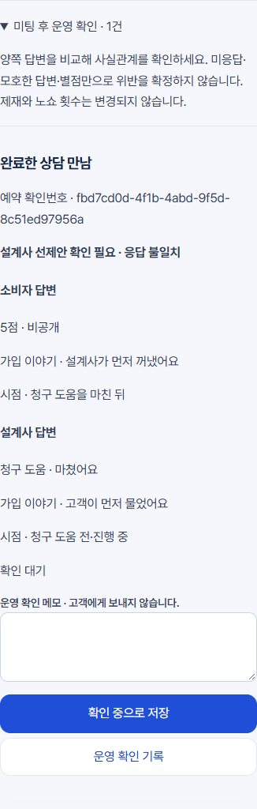
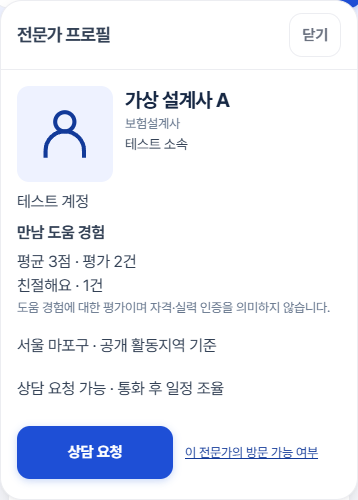

# 미팅 후 평점·양방향 확인 — 개발 검수

2026-10-12 / `codex/meeting-feedback` / 기준 `08e2d6f`.

구현·검수·화면 커밋 [54c2f0d](https://github.com/jkw2686/bohumso/commit/54c2f0d)을 개발 브랜치에 전송했다. main은 변경하지 않았다.

이전 UI·전문가 통합 개발을 유지한 후 이번 범위만 이어서 구현했다. **운영 DB·설정·배포·실제 고객 설문·외부 발송·유료 서비스 실행 없음.** 화면과 SQL은 개발 후보다. 실제 운영에 반영된 것으로 해석하지 않는다.

## 확인한 원인과 재사용

- 기존 `consultation_reviews`는 별점·긴 본문·공개 동의를 요구하고, 화면에서 5점을 기본 선택했다. 비공개 답변과 공개 집계를 분리할 구조가 없었다.
- 기존 상담 완료는 전문가 완료 요청과 고객 확인을 사용한다. 이 흐름을 재사용하고, 단순 신청·상태 문자열만 완료인 예약은 평가를 거부한다.
- 즉시 방문의 `COMPLETED`는 전문가의 완료 알림이었으므로 고객의 실제 만남 확인 시각을 별도로 추가하는 후보를 준비했다. 기존 상태·예약·연락 절차는 유지한다.
- 기존 예약 행·문제 신고·프로필 상세보기·관리자 예약 화면·공통 버튼과 디자인 토큰을 재사용했다. 다른 설문 페이지나 전문가가 소비자에게 별점을 주는 기능을 만들지 않았다.

## 화면

- 소비자: 「오늘 만남은 어떠셨나요?」, 무선택 별점, 선택 태그, 별도의 무선택 공개 동의, 문제 알리기, 제출/나중에. 별점 없이 운영 답변만 제출할 수 있다.
- 설계사: 「이번 만남을 확인해 주세요.」, 청구 도움 상태와 신규 가입 이야기 질문. 소비자 답변은 제공하지 않는다.
- 가입 이야기·시점 질문은 보험설계사 청구 도움 만남에만 표시하고 서버에서도 제한한다. 일반 보험 관리·세무 상담에는 그대로 적용하지 않는다.
- 고객/설계사가 먼저 이야기했다는 선택에만 시점 질문이 나온다. 다른 선택으로 바꾸면 시점은 지워지고 필수 검사에서 빠진다.
- 「실제로 만나지 않았어요」는 기존 예약 문제 확인으로 연결한다. 별점 작성과 실제 만남 확인을 혼동하지 않는다.
- 관리자의 「미팅 후 운영 확인」을 예약 관리 첫 영역에 배치한다. 양쪽 원문·불일치·선제안·문제 알림·현재 상태·비공개 메모를 함께 확인한다. 낮은 점수나 모호한 응답만으로 제재하지 않는다.
- 프로필 상세에만 평가 수·선택 태그 집계·조건을 충족한 평균을 표시한다. 소비자 이름·예약 시각·운영 답변 원문은 공개하지 않는다.

### 모바일 캡처

가상 계정·격리 DB의 390px 화면이다. 긴 구성요소 캡처에서 고정 상단/하단 메뉴가 중간에 중복 인쇄되는 것을 피하려고 **캡처에 한해서** 해당 메뉴를 숨겼다. 실제 클릭 검사는 메뉴를 유지했다. 프로필의 평균 3점/2건은 공개 기준 2건을 넣은 테스트 값이며 운영 정책이 아니다.

| 소비자 | 설계사 |
|---|---|
|  |  |

| 관리자 | 프로필 |
|---|---|
|  |  |

## 공개·비공개와 중복 방지

- `kind + meeting_id + respondent_role` 고유키로 만남당 소비자 응답 하나만 유지한다. 일정 변경은 새 평가로 계산하지 않는다.
- 서버가 로그인 사용자·예약 당사자·양측 완료 확인을 검사한다. 타인·자기 자신 평가·설계사의 소비자 별점 작성은 차단한다.
- 예약 행 잠금, 만남 단위 잠금, 버전 비교, 동일 요청 지문으로 중복 제출과 오래된 수정 응답을 처리한다. 저장 중 버튼 잠금, 실패 시 값 유지, 재접속 조회를 연결했다.
- 공개 동의 버전은 `meeting-rating-public-2026-10-12-v1`이다. 공개 동의한 별점만 평균/건수에, 동의한 태그만 태그 집계에 포함한다. 동의 변경과 답변 수정은 비공개 이력에 남긴다.
- 기존 공개 동의 후기 중 실제 완료 조건을 만족하는 별점은 기존 자료 그대로 한 번 포함한다. 같은 상담에 새 소비자 응답이 있으면 새 응답만 사용한다. 새 응답에서 동의를 철회해도 이전 점수가 다시 살아나지 않는다.
- 기존 긴 후기 원문은 공개 카탈로그와 상대방 예약 조회에서 제거한다. 본인 및 관리자 조회·기존 관리자 검토는 유지한다. 기존 후기 비공개 처리는 개인정보·부적절한 내용·실제 만남 여부 사유로 제한하며, 낮은 점수를 사유로 하는 선택지는 없다.
- 새 평가를 지도 순위에 연결하지 않는다. 기존 후기에서 계산한 정렬 순서만 별도 순서값으로 전달해 기존 거리/동점 분야 정렬을 유지한다. 새 공개 평균은 그 정렬에 사용하지 않는다. 요금·반경·노출·제재 로직 변경 없음.
- 어느 한쪽이라도 설계사 선제안이라고 답하면 시점이 도움 이후여도 운영 확인 대상이다. 확정적인 응답이 다른 경우 불일치 표시. 미응답/모름을 위반으로 보지 않는다.
- 한 만남의 운영 확인 건도 하나만 존재한다. 새 답변 수정은 확인 대기로 돌아오고, 같은 요청 재전송은 건수나 검토 상태를 바꾸지 않는다. 높은 별점은 확인 건을 제거하지 않는다. 설문에서 위반 횟수·정지·제명·고객 알림을 실행하지 않는다.

## 평균 공개 기준

현재 운영용 후기 코드에는 평균 공개 최소 건수가 없었다. 과거 격리 테스트의 낮은 점수 검토 수치는 공개 기준으로 재사용하지 않았다.

**5건부터 평균 공개를 제안한다. 확정 정책으로 적용하지 않았다.** `private.feedback_policy.minimum_public_count`는 기본 NULL이다. 승인을 받아 값을 설정하기 전에는 평가 수가 있어도 「평가 모으는 중」, 0건은 「아직 평가가 없어요」로 표시한다. 2건은 격리 테스트에만 사용했다.

## DB 변경 후보와 원복

파일: `supabase/065_meeting_feedback.sql`. BEGIN/COMMIT 한 트랜잭션, 반복 실행 가능. 기존 가입·예약·자료·요금 데이터 삭제, 컬럼 삭제, 타입 변경 없음.

| 대상 | 변경 |
|---|---|
| `private.feedback_backup` | 원본 함수 정의 보관 |
| `private.feedback_policy` | 평균 공개 최소 건수, 기본 미설정 |
| `private.meeting_feedback` | 양측 응답·공개 동의·버전·중복 방지 |
| `private.feedback_checks` | 만남당 한 운영 확인 건·상태·메모 |
| `private.feedback_events` | 답변·동의 변경·실제 만남 확인·운영 기록 이력 |
| `private.urgent_requests` | `customer_completed_at timestamptz` 추가 |
| 공개 RPC | `meeting_feedback` 추가, 기존 workspace/command/catalog를 백업 후 감쌈 |
| 접근권한 | 새 5개 테이블 RLS 및 일반 역할 직접 접근 금지. 인증된 참여자 본인 답변만, 관리자만 양측 답변, 익명은 공개 집계 카탈로그만 |
| Storage | 변경 없음 |

별도 저장 구조가 필요한 이유: 기존 후기의 점수·본문·공개 동의 강제 조건을 그대로 둔 채 선택 답변과 두 역할을 저장할 수 없고, 원문 공개 권한과 운영 답변을 분리해야 한다. 기존 후기를 삭제하거나 광범위하게 타입 변경하는 대신 추가 비공개 저장과 기존 만남 ID를 사용했다.

`supabase/rollback_meeting_feedback.sql`: 기존 함수 복원, 새 RPC 접근 중단, 응답·이력·추가 컬럼 보존. **새 응답이 기존 공개 후기와 겹치면 원복을 중단한다.** 그대로 옛 카탈로그를 복원하면 철회한 공개 동의가 다시 노출될 수 있기 때문이다. 이때 동의 보호 조회를 유지하는 별도 원복 검토가 필요하다. 운영 적용 후 다른 작업이 함수를 수정했다면 그 차이도 먼저 비교해야 한다.

065는 이 브랜치의 062~064 후보 뒤에서 검증했다. 운영 스키마와 migration 번호 충돌 비교·운영 백업은 이번에 실행하지 않았다. 승인 없이 운영에서 실행하지 않는다.

## 검수 결과

검증: 실제 빌드 페이지 + 가상 로그인 + 격리 PGlite SQL. 운영 Supabase 및 외부 통신은 사용하지 않았다.

| 시나리오 | 결과 |
|---|---|
| 별점만 / 비공개 질문만 / 동의 거부 답변 | 통과 |
| 없음 / 고객 먼저 / 설계사 먼저 / 시점 조건 | 통과 |
| 양측 불일치 / 한쪽 미응답 / 모름 | 통과 |
| 높은 점수와 선제안 확인 건 동시 유지 | 통과 |
| 중복 클릭·재전송·수정·동의 철회 시 평균/건수 | 통과 |
| 기존 후기와 중복 집계 방지·일정 변경 | 통과 |
| 미완료·타인·자기 평가·익명 쓰기 차단 | 통과 |
| 상대방 비공개 답변·직접 테이블 접근 차단 | 통과 |
| 방문 완료 → 고객 실제 만남 확인 → 별점 저장 → 재조회 | 통과 |
| 실패 시 소비자 입력/관리자 메모 보존·자동 새로고침 보호 | 통과 |
| 나중에 / 기존 문제 신고 이동 / 키보드 별점 | 통과 |
| 360·390·430·1440px, 루트 글자 200%, 44px 선택/버튼, 가로 넘침 | 통과 |
| DB 반복 적용·원복 반복·재적용 보존·동의 위험 원복 중단 | 통과 |
| 기존 예약 빈 상태·필터·새로고침 | 회귀 통과 |
| 기존 프로필 사진/편집/실패/다중 선택/지도로 복귀 | 회귀 통과 |
| 실제 단말·OS 확대·화면 읽기·키보드 | 미확인 |
| 운영 다중 DB 연결의 동시 제출 경합·OAuth/SMS 왕복 | 미확인 |
| 실제 설문 수신·실제 고객 평가·운영 DB 적용 | 실행하지 않음 |

기본 본문/주요 버튼/선택 배경의 실제 정의된 색상 토큰 조합 대비 계산은 각각 10.35:1 / 6.68:1 / 7.23:1. 전체 운영 페이지의 모든 상태를 측정했다는 의미는 아니다.

빌드, SQL 시나리오 3개, 정렬 독립성 단위 검사 1개, 새 브라우저 시나리오와 기존 예약/프로필 브라우저 회귀 통과. 새 브라우저 원시 결과는 `meeting-feedback-browser-results.json`. 초기에 메모리 DB 실행의 V8 메모리 할당 오류가 있었으며 SQL 검사를 프로세스별 순차 실행으로 분리했다. 검증 과정에서 원복 변수 이름 충돌과 기존 후기 비공개 요청의 누락값 처리를 수정하고 재검사했다.

```text
node scripts/build.mjs
node scripts/test-meeting-feedback.mjs
node --test tests/feedback-ordering.test.mjs
node --liftoff-only --no-wasm-tier-up tests/meeting-feedback-browser.mjs
node tests/requests-page-browser.mjs
node tests/profile-usability-browser.mjs
```

무거운 DB/브라우저 검사는 하나씩 실행한다. 상시 미리보기 서버나 공개된 신규 버전 URL은 없다.

## 변경 파일과 다음 확인

- 공통 설문/저장/관리자 확인: `src/meeting-feedback.js`, `src/workflow.js`, `src/expert-visits.js`, `public/admin-requests.html`, `public/account.css`.
- 공개 집계 전달/프로필/기존 순서 보존: `public/expert-profile-card.js`, `public/map.js`, `public/home-map.js`, `src/directory.js`, `src/consultation-ui.js`.
- DB: 위 065 및 원복 파일.
- 검수: `tests/meeting-feedback-fixture.mjs`, `tests/meeting-feedback.test.mjs`, `tests/meeting-feedback-browser.mjs`, `tests/feedback-ordering.test.mjs`, `scripts/test-meeting-feedback.mjs`.
- 첫 홈 구조·문구·브랜딩은 이번에 변경하지 않았다. 홈 지도는 상세 프로필로 집계 데이터를 넘기는 부분만 추가했다.
- 다른 작업본의 계정/공통 CSS/지도/예약/RPC 변경과 통합할 때 충돌 가능. 해당 작업본은 수정하지 않았다. Claude Code의 현재 실행 작업을 직접 확인했다고 주장하지 않는다.
- 대표 결정: 평균 공개 최소 건수, 추가 운영 답변/이력의 보관·삭제 범위. 운영 적용 전 스키마/권한 비교와 실제 단말 검증, 별도 승인 필요.
