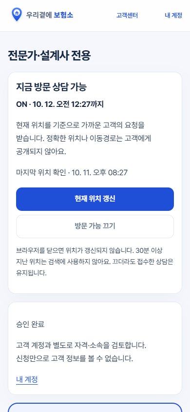
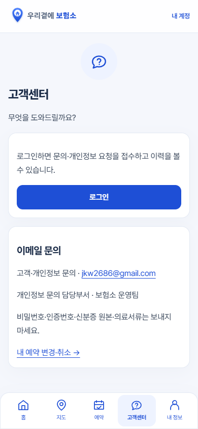
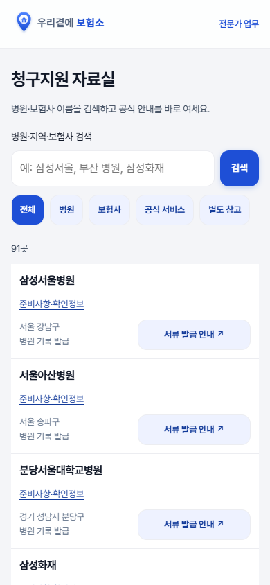

# main fec525a 검토·운영 재배포

2026-10-11, Codex. 사용자 지정 main `fec525af7e9b94345465f4902f139f434e1ef7c0`를 격리된 작업본에서 검토했다. 앱 소스는 `9b8c856`과 같으며 이후 커밋은 문서 변경이다. 이번 검토에서 기능 코드·DB·환경변수를 추가 변경하지 않았다.

## 배포 결과

- 운영: https://bohumso.netlify.app/
- Netlify 배포: `6acb7510728c689eee310184`
- production / main / `fec525af7e9b94345465f4902f139f434e1ef7c0` / ready / error 없음
- 공개 시각: **2026-10-11 20:38:04 KST** (`2026-10-11T11:38:04.221Z`)
- Netlify의 Git 빌드를 요청했다. 다른 작업본의 로컬 파일을 수동 업로드하지 않았다.
- 기존 `9b8c856` 배포도 ready였음을 확인한 후 사용자 요청대로 현재 main을 재배포했다.

## 직접 실행한 검사

| 검사 | 결과 | 범위 |
|---|---|---|
| `node scripts/build.mjs` | 통과 | 클라이언트·함수 빌드, 출력 검사 |
| 전체 `tests/*.test.mjs` | **123/123 통과**, 실패 0 | 격리 DB, 권한·예약·동의·프로필·SMS/결제 모의 처리 등; 약 409초 |
| `expert-profile-page-browser.mjs` | 통과 | 상단 방문 카드, 프로필/상담 설정 펼침·저장·요약, 360/390/430/1440, 키보드·대비 |
| `support-entry-browser.mjs` | 통과 | 소비자 5탭·전문가 고객센터 진입·44px·모바일 넘침 |
| `ui-icons-motion-browser.mjs` | 통과 | 공통 아이콘·감속 환경·움직임 최소화·4폭 |
| `map-empty-waitlist-browser.mjs` | 통과 | 빈 지역 안내·지역값·48px·미준비 상태 안내 |
| `claim-resources-browser.mjs` | 통과 | 한 칸 검색·분류·공식 링크·상세·320~1440·선택 전문가/일정 유지 |
| `home-experts-browser.mjs` | 통과 | 공개 전문가·같은 좌표·키보드·작은 팝업·독립 조회 실패 |
| `visit-map-icons-browser.mjs` | 통과 | 숫자 묶음·펼침·보험소/전문가 구분·필터·4폭 |

Windows의 기존 Edge/Node 24 및 설치된 의존성을 사용했다. 무거운 PGlite 단위검사는 다음 방식으로 한 번 실행했다.

```text
node --liftoff-only --no-wasm-tier-up --wasm-num-compilation-tasks=1 --test --test-concurrency=1 tests/*.test.mjs
```

브라우저 검사는 먼저 빌드한 뒤 `node tests/<파일명>`으로 실행한다. 전문가 프로필 연결 검사에도 같은 Wasm 옵션을 사용했다. 모든 자동 검사는 가상 계정·격리 DB/모의 요청이며 실제 고객에게 발송하지 않았다.

## 운영에서 읽기로 확인한 것

- 홈의 상황 카드, 회원가입 안내, 하단 홈·지도·예약·고객센터·내 정보.
- 기존 로그인 세션으로 전문가 화면이 열림. 방문 상담 카드가 먼저 나오고, 프로필 수정 버튼으로 기존 사진·소개 편집 영역이 열림. 설정을 저장하거나 ON/OFF를 조작하지 않았다.
- 지도 공개 목록의 두 전문가와 숫자 묶음 핀. 목록을 닫고 키보드 Enter로 묶음을 펼쳐 전문가 핀이 나타남.
- 고객센터의 로그인 후 문의 입력 화면과 하단 메뉴.
- 관리자 문의의 미처리 건수, 열린 문의 영역, 한글 상태. 원문 내용·응답·권한을 변경하지 않았다.
- 확인한 운영 화면의 콘솔 error 없음. 새 배포 완료 후 홈페이지를 다시 열어 표시를 확인했다.

## 화면 증거

아래는 **운영 계정 화면이 아닌 격리 테스트 화면**이다. 운영 개인정보는 포함하지 않는다.





## 남은 범위와 인수인계

- 이번 검토에서 새 배포를 막는 오류는 발견하지 않았다. 전체 브라우저 57개 재실행·기존 실패 목록 해소를 완료했다고 주장하지 않는다. 사진 드래그 테스트의 기존 비결정적 실패도 이번에 재실행하지 않았다.
- 실제 휴대전화 키보드·GPS·새 OAuth 로그인·운영 저장/예약 E2E·문자/결제/유료 AI는 실행하지 않았다.
- DB057/058/059는 적용하지 않았다. ROADMAP 4단계의 동기화·패키지·리허설이 다음이며, 5단계는 지정 승인과 백업 확인이 필요하다.
- 별도 `work/bohumso-ui-release`의 미커밋 interaction-settings 작업은 운영에 포함하지 않았다. 해당 작업본 HEAD `204bed6`, 원격 동일 브랜치 `a4890f7`과 차이가 있다. 로컬 체크포인트는 그 작업본 `docs/interaction-settings-handoff.md`에 기록했다. main 공통 파일과 겹치므로 덮어쓰지 않는다.
- 후속 단계 예상시간은 HANDOFF_CODEX의 기존 4~9단계 추정표를 유지한다. 이번 배포 검증 실측과는 구분한다.
- 앱 문제를 되돌릴 때에는 관련 커밋을 검토해 revert한 새 소스를 재배포한다. 이번에 운영 DB가 바뀌지 않았으므로 DB 원복은 없다.
