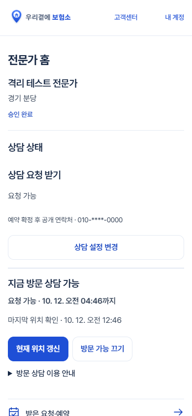

# 출시 전 앱 화면 정리 — 2026-10-12

개발 브랜치 `codex/mobile-ui-polish`에 구현. **운영 배포·DB·설정 변경·외부 발송·비용 집행 없음.** 기준 커밋은 `65580fd`이다.

개발 반영: [0bb7a1a](https://github.com/jkw2686/bohumso/commit/0bb7a1a). 개발 브랜치 전송 완료, main 병합 없음.

## 수정한 화면

| 화면 | 변경 | 주요 파일 |
|---|---|---|
| 전문가 홈 | 이름 → 상담 상태 → 받은 요청·예약 → 주요 메뉴. 기존 입력을 재사용하며 활동 정보와 자료 제출은 펼쳐서 확인 | `public/partner.html`, `src/expert-home.js`, `src/account.js`, `src/partner-onboarding.js`, `src/expert-early-access.js` |
| 병원·보험사 자료실 | 검색·분류·기관 목록 우선. 공식 안내와 상세보기 버튼 구분. 확인 상태와 기관 데이터·URL 유지 | `public/claim-resources.html`, `.css`, `.js` |
| 성장·실천 | 할 일 바로 입력, 날짜·메모는 선택 펼침. 나의 실천과 읽을거리 구분. 완료·지난 일정 접힘 유지 | `public/growth.html`, `.css`, `src/growth.js` |
| 프로필·자료 제출·상담 상태 | 선택 입력 유지, 조회·저장 실패 안내, 저장 중 중복 입력 방지. 파일명·동의·제출·처리 결과 구분 | `src/optional-profile.js`, `src/profile-editor.js`, `src/early-documents.js`, `src/expert-visits.js` |
| 예약·내 정보·고객센터 | 예약 상대방·시간·방식·상태 순서. 계정 메뉴 행 확대. 문의와 대화 중심으로 정리 | `public/requests.html`, `public/account.html`, `public/partner-work.html`, `public/support.html`, `src/workflow.js`, `src/support-chat.js` |
| 공통 | 흰 배경·구분선·Pretendard·26px 제목·16px 본문·14px 보조·48px 버튼·60px 메뉴. 선택한 7개 페이지에만 적용 | `public/app-ui.css` |

자료실은 `account.css`를 사용하지 않아 간격 토큰 일부가 정의되지 않는 문제도 있었다. 공통 앱 화면 범위에 기존 값과 같은 간격 토큰을 정의했다. 홈 전역 스타일 끝에 규칙을 추가하지 않았다.

## 모바일 수정 전후

390px 실제 페이지, 격리 계정. 수정 전은 기준 커밋의 HTML/CSS와 변경 전 번들로 첫 빌드 전에 캡처했다. 긴 화면은 전체 캡처를 열어 확인한다.

| 화면 | 수정 전 | 수정 후 |
|---|---|---|
| 전문가 홈 | [전](ui-polish-screens/before-partner-390.png) | [후](ui-polish-screens/after-partner-390.png) |
| 자료실 | [전](ui-polish-screens/before-claim-resources-390.png) | [후](ui-polish-screens/after-claim-resources-390.png) |
| 성장·실천 | [전](ui-polish-screens/before-growth-390.png) | [후](ui-polish-screens/after-growth-390.png) |

## 줄이거나 옮긴 설명

- 전문가 홈의 가입 단계 반복 노출 → 기존 **활동 정보·상담 시간**에서 수정.
- 현재 위치 이용·30분 만료 설명 → **방문 상담 이용 안내**. 켜기 직전 위치 동의와 자동 종료 선택은 유지.
- 자료실의 제목 반복 소개 삭제. 준비사항·확인일·출처·복사·제보는 **상세보기**, 수록 범위와 비교는 기존 안내 영역 유지.
- 성장·실천의 공간 소개와 긴 빈 상태 설명 축약. 고객 개인정보 금지 안내는 입력창에 유지.
- 고객센터의 답변 대기 설명 한 문장으로 축약. 서비스 구분은 **문의 이용 안내**, 민감정보 주의는 대화 입력 위치에도 유지.
- 자료 제출의 필수 개인정보·동의·거부 결과 설명은 삭제하지 않음.

## 기능 검수

모든 검수는 로컬 PGlite 또는 격리 응답과 가상 계정으로 수행했다. 운영 서비스로 요청을 보내지 않았다.

| 항목 | 결과·근거 |
|---|---|
| 실제 7페이지 360·390·430·1440px, 200% 글자 확대 | 통과. 가로 넘침 없음, 노출 버튼 최소 44px. 확대 시 프로필·선택 입력·자료 상세·새 문의 입력을 펼쳐 확인. `tests/ui-polish-browser.mjs` |
| 전문가 메뉴·상담 설정·프로필 저장 | 통과. 저장 후 요약·새로고침 유지, 실패 시 입력 보존. `tests/expert-profile-page-browser.mjs`, `tests/ui-polish-browser.mjs` |
| 일반 상담 수신과 지금 방문 | 통과. 독립 상태 유지, 위치 동의·자동 종료 선택, OFF 및 다시 ON. 저장 실패 때 저장된 요약은 유지 |
| 사진·소개 | 통과. 등록·크롭·변경·삭제·오류·캐시·기본 아바타·전체 소개·다른 전문가 선택·지도 복귀. `tests/profile-usability-browser.mjs` |
| 자료 제출 | 동의 전 요청 차단, 선택 파일 표시, 실패 후 파일 유지 통과. 실제 비공개 Storage 업로드는 미확인 |
| 자료실 | 검색·분류·신청자별 안내·키보드 상세·공식 URL·복사 통과. URL은 변경하지 않음. `tests/claim-resources-browser.mjs` |
| 실천 | 추가·수정·완료·되돌림·삭제·새 로그인 유지·실패·응답 유실 재시도 통과. `tests/growth-browser.mjs` |
| 예약 | 격리 예약이 있는 실제 페이지의 상대방·일정·상태 순서 통과. 빈 상태·필터·새로고침 및 기존 변경·취소 UI 통과. `tests/requests-page-browser.mjs`, `tests/appointment-care-browser.mjs` |
| 고객센터 | 소비자·전문가 문의, 운영자 답변, 읽음, 재접속, 실패 재시도, 초안 보호, 타인 문의·일반 계정 관리자 접근 차단 통과. `tests/support-chat-browser.mjs` |
| 대비·키보드 | 프로필 주요 조작 대비 8.04:1, 대화 검수 표본 최저 4.76:1. Enter 펼침·포커스·작은 화면 입력 확인 |
| 빌드 | 통과. `node scripts/build.mjs`. 배포하지 않음 |

레이아웃 원시 결과: [ui-polish-results.json](ui-polish-results.json). 화면별 캡처·상태 변경 증거는 로컬 `artifacts/ui-polish/`, 프로필·성장·고객센터 기존 검수 캡처도 남아 있다.

## 미확인·후속

- 실제 Android/iPhone 키보드, 카카오 인앱 브라우저, OS 글자 확대는 미확인. 브라우저의 짧은 뷰포트·루트 글자 200% 검수와 구분한다.
- 운영 OAuth·SMS·실계정 저장·비공개 Storage 업로드는 실행하지 않음. 외부 기관 링크의 온라인 유효성은 이번 디자인 작업에서 재검증하지 않음.
- 별도 지도 공개 스위치는 현재 기준에 없어 신설하지 않음. 상담 수신 상태를 지도 공개 상태라고 표시하지 않음.
- 현재 위치 실패 안내·위치 유효시간·일반 상담 저장 필수 항목·예약 정책은 기존 기준 유지.
- 별도 작업본 `../bohumso-ui-release`의 수정 파일을 읽기 전용으로 확인했다. Claude Code 실행 중 작업은 직접 확인하지 못했다. `account.js`, `optional-profile.js`, `profile-editor.js`, 계정·전문가·예약·고객센터 HTML, `design-system.md`, 프로필 테스트는 병합 시 충돌 가능하다. 그 작업본의 수정과 058 SQL을 가져오거나 되돌리지 않았다.

## 홈·운영 영향 및 되돌리기

`public/index.html`, `public/styles.css`, `public/type-system.css`, 기관 데이터·URL 파일, SQL, Netlify 설정은 변경하지 않았다. 홈은 새 공통 CSS를 로드하지 않는다. 인증·API·권한·요금·가입 정책 변경 없음.

배포 없음. 공개 사이트는 이전 배포를 유지한다. 되돌릴 경우 기준 `65580fd`와 이 브랜치를 비교해 이번 변경만 되돌린다. 다른 작업본을 원격 main으로 덮어쓰거나 일괄 초기화하지 않는다.

검수 재실행은 `node scripts/build.mjs` 후 표에 적힌 브라우저 검수 파일을 **하나씩 순서대로** 실행한다. 초기 수정 전 캡처는 보관된 이미지를 사용한다.
